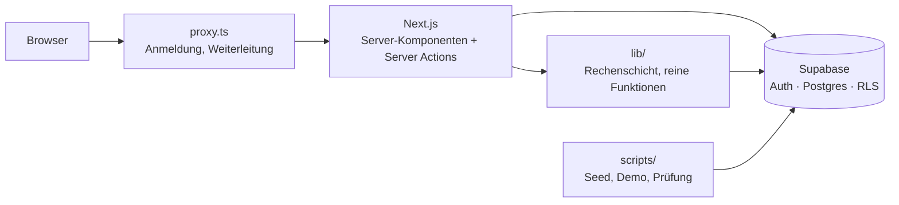

# Architektur

Für Entwickler, die Bellegio zum ersten Mal sehen. Die **Begründungen** stehen in [../entscheidungen/](../entscheidungen/README.md), das **Datenmodell** in [datenmodell.md](datenmodell.md), die **Rechenregeln** in [rechenlogik.md](rechenlogik.md).

## Überblick

- **Next.js 16** (App Router), React 19, Tailwind 4, `react-hook-form` + Zod, `recharts`, Vitest.
- **Supabase** für Anmeldung (inkl. Zwei-Faktor), Postgres und Zeilenschutz (RLS).
- Mandanten: **Träger → Einrichtungen → Gruppen, Kinder, Team**. Der Zugriff wird in der Datenbank erzwungen ([0002](../entscheidungen/0002-zugriff-im-zeilenschutz.md)).
- Diese Next.js-Version weicht von älteren ab (`proxy.ts` statt `middleware.ts`, `retry` statt `reset` in `error.tsx`). Vor Änderungen die mitgelieferte Doku in `node_modules/next/dist/docs/` lesen (siehe `AGENTS.md`).

## Ordnerkarte

| Ordner | Inhalt |
| --- | --- |
| `app/(auth)` | `login`, `mfa`, `passwort-setzen`, `passwort-vergessen` |
| `app/(onboarding)` | `einrichtung-auswahl` (inkl. Route Handler `oeffnen`), `zustimmung` (AGB/AVV) |
| `app/(app)` | Kunden-App: `dashboard`, `gruppen`, `kinder`, `team`, `controlling`, `szenario` (Menü „Planung“), `einstellungen/*` |
| `app/(admin)/admin` | Betreiber-Zentrale: Abrechnung, Einnahmen, Rechnungen, Kunden, Anfragen, Betreiberdaten |
| `app/(marketing)/marketing` | Marketing-Ampel, trägerweit, ohne Einrichtungs-Kontext |
| `app/` (öffentlich) | Landingpage, `impressum`, `datenschutz`, `agb`, `avv`, `tom`, `unterauftragnehmer`, `robots`, `sitemap` |
| `components/` | UI nach Fachbereich (`dashboard`, `forecast`, `gruppen`, `kinder`, `team`, `szenario`, `einstellungen`, `admin`, `marketing`, `landing` …); `ui/` = Grundbausteine (shadcn/base-ui) |
| `lib/` | Geschäftslogik, deutsch benannt (Tabelle unten) |
| `supabase/migrations` | alle Datenbankänderungen, Reihenfolge = Dateiname (81 Dateien) |
| `supabase/tests` | SQL-Prüfungen für Zugriffsregeln (manuell, nicht in der CI) |
| `tests/` | 54 Vitest-Dateien für reine Funktionen (keine UI-/End-to-End-Tests) |
| `scripts/` | Seed-, Demo-, Prüf- und Screenshot-Skripte (laufen mit `tsx`) |
| `types/database.types.ts` | generierte Supabase-Typen (bei Schemaänderungen von Hand nachgezogen) |
| `docs/` | diese Dokumentation |

### `lib/` im Überblick

| Ordner | Zweck | Wichtigste Dateien |
| --- | --- | --- |
| `supabase/` | Clients und Session-Erneuerung | `server.ts`, `proxy.ts`, `service-role.ts` |
| `server/` | Rechte, aktive Einrichtung, MFA, Zustimmung | `current-user-role.ts`, `active-einrichtung.ts` |
| `actions/` | alle Server Actions (Schreiben) | `kinder.ts`, `team.ts`, `berechtigungen.ts`, `admin.ts` |
| `forecast/` | Monatsreihe als Zusammenführung | `monthly-forecast.ts` |
| `team/` | Personalbedarf je Bundesland | `personalplanung.ts`, `anstellungsschluessel.ts`, `personalschluessel-bw.ts`, `personalschluessel-nrw.ts` |
| `finanzen/` | Förderung, Personalkosten, Elternbeiträge, Ergebnis | `foerdererloese.ts`, `personalkosten.ts`, `ergebnis.ts`, `elternbeitraege.ts` |
| `dashboard/` | Kennzahlen aus Kinderzeilen | `presence.ts` |
| `steuerung/` | Cockpit, Ampeln, Handlungsliste | `lade-steuerung.ts`, `kita-ampel.ts`, `handlungen.ts` |
| `belegung/` | Belegungs-Vorschau, Wechselvorschläge | `vorschau.ts` |
| `ausblick/` | Personal-Ausblick über mehrere Monate | `personal-ausblick.ts` |
| `planung/` | Kitajahr-Planung | `kitajahr.ts`, `lade-kitajahr.ts` |
| `regelwerk/` | Versionierung der Gesetzeswerte, Rechtsstand-Hinweise | `verlauf.ts`, `rechtsstand.ts` |
| `kinder/` | Historien, I-Status, Basisfaktor, Gruppen-Passung | `buchungszeit-historie.ts`, `gruppen-historie.ts` |
| `controlling/` | Zeitraum, Kategorisierung | `jahreskategorisierung.ts` |
| `import/` | Excel/CSV-Import (erst prüfen, dann schreiben) | `kinder.ts`, `team.ts`, `abgleich*.ts` |
| `nutzer/` | Bereiche und Regeln der Nutzerverwaltung | `bereiche.ts`, `verwaltung.ts` |
| `marketing/`, `admin/`, `datenschutz/`, `rechtstexte/`, `suche/`, `ui/` | je ein Fachbereich | |

## Der Weg einer Anfrage

1. **`proxy.ts`** (→ `lib/supabase/proxy.ts`) erneuert die Anmeldung und leitet um: nicht angemeldet → `/login`; angemeldet ohne aktive Einrichtung → `/einrichtung-auswahl`. Öffentlich sind nur Landingpage, Rechtstexte und Passwortseiten. Rechte prüft der Proxy **nicht**.
2. **Aktive Einrichtung:** ein Cookie (`bellegio_active_einrichtung`, 30 Tage). Es ist nur ein Merker und nie die Sicherheitsgrenze; die Layouts prüfen per RLS, ob die Einrichtung sichtbar ist.
3. **Layouts als Tür:** `(app)` leitet bei offener Zustimmung zu AGB/AVV nach `/zustimmung`; `(admin)` verlangt den Betreiber (sonst 404) und ggf. den Zwei-Faktor-Code; `(marketing)` verlangt das Marketing-Recht.
4. **Lesen:** Seiten sind async Server-Komponenten. Sie holen den Supabase-Client mit der Sitzung des Nutzers (RLS gilt), prüfen Rechte (`canViewControlling`, `canViewFinanzen` …) und rufen Lade- und Rechenfunktionen aus `lib/`.
5. **Schreiben:** Server Actions in `lib/actions/`. Muster: aktive Einrichtung holen → Eingabe mit einer reinen Prüffunktion validieren → Insert/Update mit dem Nutzer-Client (RLS entscheidet) → `revalidatePath`. Erwartbare Fehler kommen als `{ ok: false, error }` zurück ([0001](../entscheidungen/0001-next-und-supabase.md)); das Muster ist Konvention, aber nicht überall durchgesetzt (z. B. `auth.ts`, `team.ts` nutzen `redirect`).
6. **Datenbank:** RLS-Policies nutzen Hilfsfunktionen im Schema `app` ([datenmodell.md](datenmodell.md), Abschnitt 0 und 9).

### Die drei Supabase-Clients

| Datei | Schlüssel | Einsatz |
| --- | --- | --- |
| `lib/supabase/server.ts` | anon + Sitzung des Nutzers | Standard in Server-Komponenten und Actions; RLS gilt |
| `lib/supabase/client.ts` | anon | Browser |
| `lib/supabase/service-role.ts` | Service-Schlüssel | umgeht RLS; nur serverseitig, nur nach Rechteprüfung ([0009](../entscheidungen/0009-service-rolle-nur-serverseitig.md)): Nutzer anlegen/einladen, Betreiber-Aktionen, Gehaltssummen, Marketing-Vorschläge |

`lib/supabase/mit-zeitlimit.ts` begrenzt hängende Admin-Aufrufe auf 20 Sekunden.

## Rechenschicht

Rechenregeln sind reine Funktionen in `lib/` ([0005](../entscheidungen/0005-reine-funktionen-und-tests.md)). Meist liegen in einem Modul ein **Lader** (async, nimmt den Supabase-Client) und die **reinen Funktionen** nebeneinander, z. B. `ladePersonalplanungBasis` (lädt) und `resolvePersonalplanungKontext` / `berechnePersonalplanung` (rechnen).

**Datenfluss der Monatsreihe** (`buildForecastMonths` in `lib/forecast/monthly-forecast.ts`) — das Herz von Controlling, Dashboard, Ampeln und Planung:

1. Einmal laden: Gruppen, Bundesland, Gesetzestabellen samt Versionen (`ladePersonalplanungBasis`), optional die Finanz-Basis (`ladeFinanzenBasis`).
2. Pro Monat (oder nur an Stützstichtagen):
   - Kinder per Datenbankfunktion `kinder_presence_at_date` → Kennzahlen (`lib/dashboard/presence.ts`).
   - Team per `team_presence_for_month` (Stunden je Monat, Ausfälle).
   - Gesetzeswerte für diesen Monat auflösen (`resolvePersonalplanungKontext`) → Personalbedarf je Bundesland (`berechnePersonalplanung`).
   - Gruppen-Status (`lib/steuerung/gruppen-status.ts`).
   - Optional Finanzen (`resolveFinanzenMonat`): Förderung, Personalkosten, Elternbeiträge, Ergebnis.
3. Ergebnis: eine Liste `ForecastMonth`. `finanzen` ist bewusst optional: „kein Zugriff“ erscheint als „Feld fehlt“, nicht als 0 €.

Darauf bauen auf: Controlling und Prüfungsmappe, Dashboard (`ladeSteuerung`, `kita-ampel.ts`), Gruppen-Seite, Planung (`lade-kitajahr.ts`) und die Marketing-Vorschläge.

**Versionierte Gesetzeswerte:** zwei Muster ([0006](../entscheidungen/0006-versioniertes-regelwerk.md), [0008](../entscheidungen/0008-historien-statt-ueberschreiben.md)): Kinder-Historien nur mit `gueltig_ab` („größtes `gueltig_ab ≤ Stichtag`“, `lib/kinder/*-historie.ts`), Regelwerk mit `gueltig_ab`/`gueltig_bis` und Historientabelle (`lib/regelwerk/verlauf.ts`).

## Build, Betrieb, Skripte

| Thema | Stand |
| --- | --- |
| Skripte | `dev` (Turbopack), `build` = `next build --webpack`, `start`, `lint`, `test` = `vitest run`; kein `typecheck`-Skript, die CI ruft `npx tsc --noEmit` |
| Warum `--webpack` | [0012](../entscheidungen/0012-hosting-und-umgebungen.md) |
| Hosting | Hostinger (Node, automatischer Build bei Push auf `main`), Datenbank Supabase Frankfurt |
| Umgebungsvariablen | `NEXT_PUBLIC_SUPABASE_URL`, `NEXT_PUBLIC_SUPABASE_ANON_KEY` (werden beim Build eingebrannt, nach Änderung neu deployen), `SUPABASE_SERVICE_ROLE_KEY` (nur Server). Vorlage: `.env.example` |
| CI | `.github/workflows/ci.yml`: `npm ci`, Lint, `tsc`, Tests, Build (Node 20) bei Push auf `main` und bei Pull Requests. Nicht enthalten: Deployment, SQL-Tests, Migrationen |
| Sicherheits-Header | `next.config.ts`: CSP ohne Nonce (`'unsafe-inline'` nötig für Next-Skripte und Diagramm-Styles), `X-Frame-Options: DENY`, HSTS (Produktion) u. a. Neue externe Dienste müssen in der CSP ergänzt werden |
| Redirects | `/kosten`, `/abrechnung` → `/dashboard`; `/dokumentation` → `/einstellungen/rechtsgrundlagen` |

**Skripte** (`scripts/`, alle mit `tsx`, meist `--env-file=.env.local`): `demo-einrichten.ts` (Demo aus der Arbeitskopie ableiten), `ergebnis-pruefen.ts` (Monatsergebnis je Einrichtung, nur lesend), `landing-screenshots.ts` (Screenshots per Puppeteer), `prod-erstbetreiber.ts` und `prod-pruefen.ts` (Produktion einrichten und prüfen), `seed-milestone*.ts` (Demodaten; mehrere sind als „nicht mehr ausführen“ markiert), `import-excel.ts` (Erstimport Bayern).

## Sicherheit

- Zugriff in der Datenbank erzwingen, Oberfläche blendet nur aus ([0002](../entscheidungen/0002-zugriff-im-zeilenschutz.md), [0003](../entscheidungen/0003-rechte-je-bereich-und-gehaelter.md)).
- Service-Schlüssel nur serverseitig; es verlassen nur Aggregate den Server ([0009](../entscheidungen/0009-service-rolle-nur-serverseitig.md)).
- Fehler: `app/error.tsx` zeigt nur eine Fehlernummer. Server Actions der Nutzerverwaltung schreiben Ausnahmen in die Tabelle `server_fehler_protokoll` (lesbar nur mit Service-Rolle oder per SQL). Ein zentrales Monitoring (z. B. Sentry) gibt es nicht.
- Zwei-Faktor (TOTP) für den Betreiber; Anmeldefehler nennen nur „E-Mail oder Passwort ist falsch“.
- Rechtstexte mit Versionsnummern; Träger-Admins bestätigen AGB/AVV beim Login, sobald die Texte als geprüft gelten ([0014](../entscheidungen/0014-datenschutz-als-funktion.md)).
- Es gibt keine Selbstregistrierung. Das Abschalten von Sign-ups in Supabase ist ein manueller Schritt (siehe [../betrieb/go-live-checkliste.md](../betrieb/go-live-checkliste.md)).

## Bekannte Unstimmigkeiten (Stand 21.10.2026)

Ehrlich festgehalten, damit niemand darüber stolpert:

- Mehrere Listen- und Neuanlage-Seiten (`/kinder`, `/team`, `/gruppen`, `/kinder/neu`, `/team/neu`) haben im Seitencode keine eigene Sperre; die Seitenleiste zeigt allen Nutzern alle Punkte. Der Schutz liegt in der Datenbank, die Oberfläche zeigt ohne Recht ggf. nur leere Listen.
- Der Spalten-Schutz auf `einrichtungen` deckt neuere Spalten nicht ab (siehe [datenmodell.md](datenmodell.md), Abschnitt 1).
- CI läuft mit Node 20, Hostinger laut Notizen mit Node 22; eine `engines`-Angabe fehlt.
- Das Fehlerprotokoll in der Tabelle wird nur von der Nutzerverwaltung genutzt.
- `/robots.txt` und `/sitemap.xml` sind weder vom Proxy ausgenommen noch öffentlich gelistet (nach dem Code würde ein anonymer Aufruf nach `/login` führen; nicht geprüft).
- `docs/betrieb/produktion-einrichten.md` nennt noch 68 Migrationsdateien (aktuell 81).
- Ob die 14 Testkonten mit Passwort `test1234` noch existieren, ist widersprüchlich dokumentiert; `scripts/prod-pruefen.ts` soll sie vor dem Go-live aufspüren.
