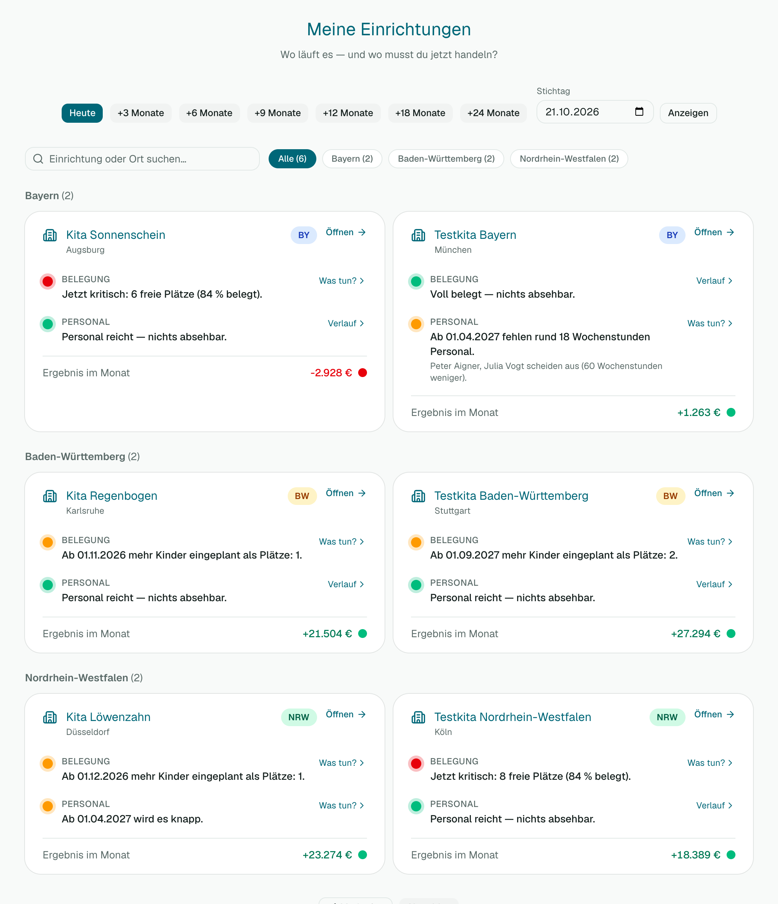
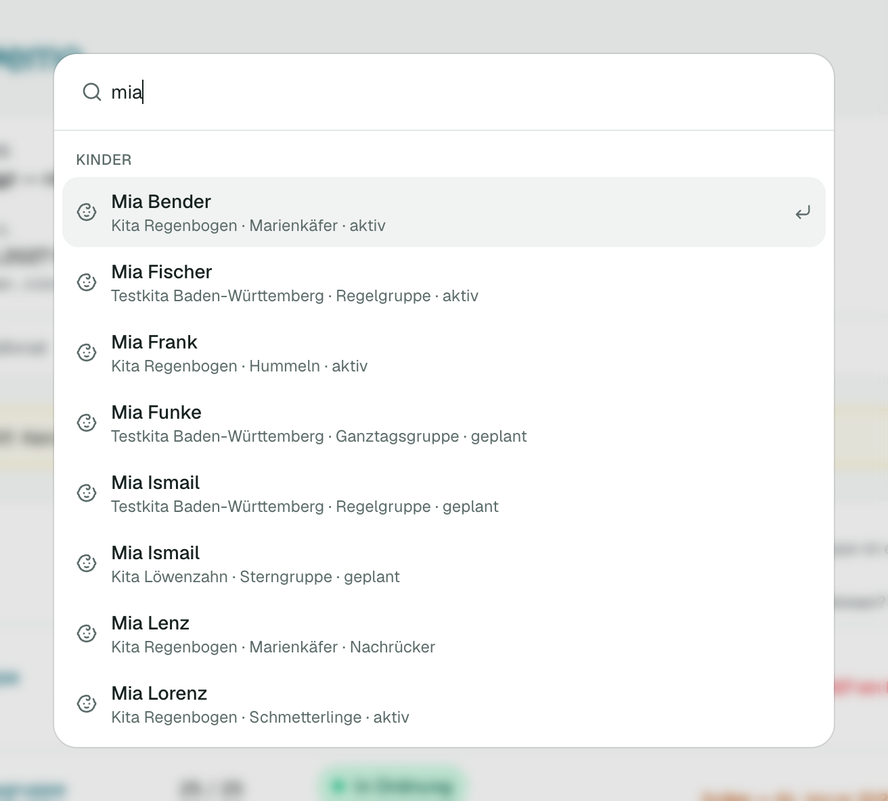

# 0 — Erste Schritte

## Anmelden

1. Öffne die Adresse deiner Bellegio-Installation und gib E-Mail und Passwort ein.
2. Hast du eine Einladung bekommen, klicke auf den Link in der E-Mail und lege ein Passwort fest.
3. Passwort vergessen? Auf der Anmeldeseite „Passwort vergessen?“ wählen, du bekommst eine E-Mail.
4. Hat dein Konto Zwei-Faktor-Schutz, fragt Bellegio zusätzlich nach dem Code aus deiner Authenticator-App.

## Deine Einrichtung wählen

Nach der Anmeldung siehst du **„Meine Einrichtungen“**: eine Karte je Einrichtung. Jede Karte zeigt zwei Ampeln — **Belegung** und **Personal** — mit einem Satz, was in den nächsten Monaten passiert. Wer Rechte für Finanzen hat, sieht außerdem das Ergebnis im Monat.

- Klicke auf den Namen oder **Öffnen**, um in die Einrichtung zu gehen.
- Hast du nur eine Einrichtung, öffnet Bellegio sie direkt.
- Oben kannst du den **Stichtag** ändern, z. B. „+6 Monate“, um zu sehen, wie es dann aussieht.
- Später wechselst du die Einrichtung oben in der Kopfzeile (Einrichtungsname → **Wechseln**).

## Das Menü

Links stehen sieben Punkte:

| Punkt | Wofür |
| --- | --- |
| Dashboard | Ampeln und Handlungsliste — „Wo muss ich jetzt etwas tun?“ |
| Gruppen | Plätze, Belegung, Nachrücker |
| Kinder | Kinderliste, Aufnahme, Buchungszeit |
| Team | Mitarbeitende, Stunden, Ausfälle |
| Controlling | Zahlen über Monate und Jahre, Prüfungsmappe |
| Planung | Das nächste Kitajahr durchrechnen |
| Einstellungen | Einrichtung, Finanzen, Nutzer, Datenschutz, Hilfe |

Ob du alle Punkte sinnvoll nutzen kannst, hängt von deinen Rechten ab. Ohne Recht siehst du einen Hinweis oder eine leere Seite.

## Suchen mit Strg+K

Drücke **Strg+K** (Mac: **Cmd+K**) oder klicke oben auf „Suchen…“. Tippe einen Namen oder eine Funktion, z. B. „Mila“ oder „Kind anlegen“. Bellegio findet Einrichtungen, Kinder, Mitarbeitende und Funktionen. Kinder siehst du nur, wenn du das Recht „Kinder & Gruppen“ hast, Mitarbeitende nur mit dem Recht „Personal“.

## Der Stichtag

Fast alle Zahlen gelten für einen **Stichtag**. Standard ist heute. Wählst du ein anderes Datum, zeigt Bellegio den Stand dann — mit allen bekannten Austritten, Eintritten und Personaländerungen. So erkennst du Engpässe früh.

## Wenn etwas nicht klappt

- **Seite leer oder „kein Zugriff“:** Dir fehlt ein Recht. Frage deine Träger-Administration.
- **Fehlermeldung mit Nummer:** Notiere die Nummer und melde sie an support@bellegio.de.
