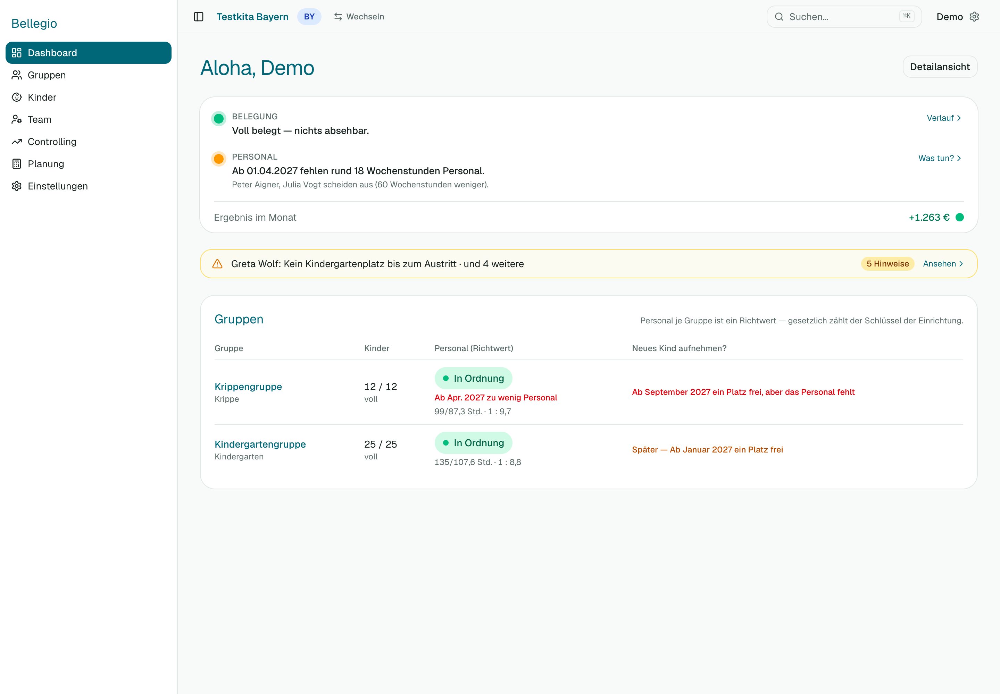
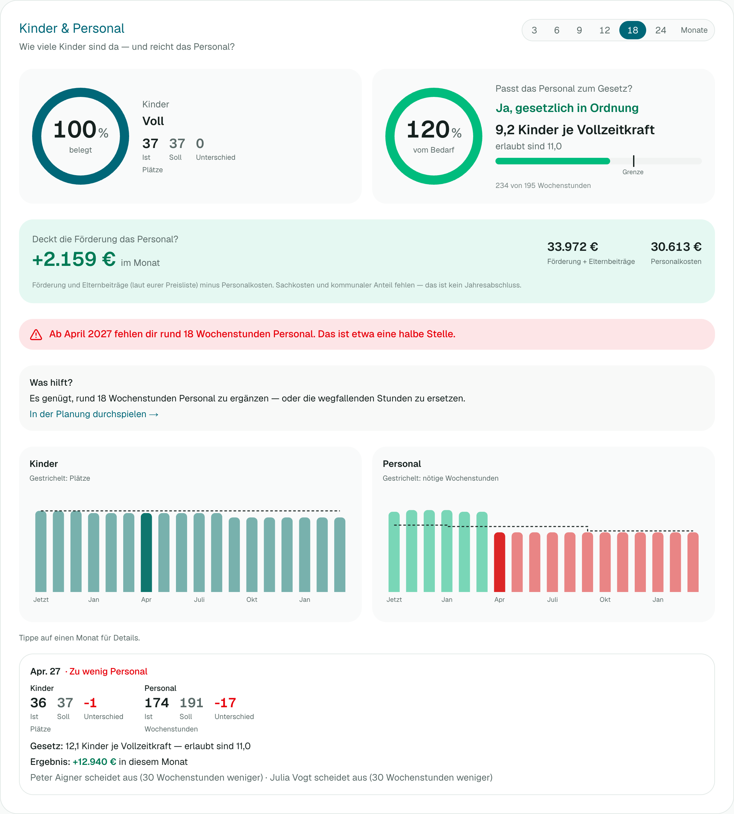

# 1 — Das Dashboard lesen

Das Dashboard beantwortet drei Fragen: **Wo läuft es? Warum? Was muss ich tun?**

## Die zwei Ampeln

Oben stehen zwei Ampeln für deine Einrichtung.

| Ampel | Was sie prüft | Grün | Gelb | Rot |
| --- | --- | --- | --- | --- |
| **Belegung** | Sind die Plätze gut gefüllt — jetzt und in den nächsten 12 Monaten? | Voll belegt | In den Monaten 4–12 wird die Auslastung unter 95 % fallen | Jetzt oder in den nächsten 3 Monaten unter 90 % belegt, oder mehr Kinder als Plätze |
| **Personal** | Reicht das Personal für die Kinder — jetzt und später? | Personal reicht | Wird knapp, oder ein Engpass kommt in 4–12 Monaten | Jetzt oder in den nächsten 3 Monaten zu wenig Personal |

Neben jeder Ampel steht ein Satz, z. B. „Ab 01.04.2027 fehlen rund 18 Wochenstunden Personal. Peter Aigner und Julia Vogt scheiden aus.“ Das ist der **Grund**.

Blau heißt: **mehr Personal als nötig** bzw. **Plätze frei** — kein Fehler, aber vielleicht Spielraum.

## „Was tun?“ und Maßnahmen

Ist eine Ampel gelb oder rot, steht daneben **Was tun?**. Ein Klick öffnet ein Fenster:

1. Du siehst **Vorschläge** — bei Belegung z. B. „Nachrücker prüfen“, „Warteliste kontaktieren“, „Info-Nachmittag“; bei Personal z. B. „Stunden aufstocken“, „Stelle ausschreiben“, „Aufnahme verschieben“.
2. Wähle einen Vorschlag oder schreibe eine eigene Maßnahme, ergänze eine Notiz und einen Zielmonat.
3. Klicke **Maßnahme festhalten**.

Darunter steht der **Verlauf**: wer wann was beschlossen hat und ob es erledigt ist. So geht nichts verloren, auch wenn mehrere Personen mitarbeiten. Maßnahmen zur Belegung brauchst du das Recht „Kinder & Gruppen ändern“, zum Personal das Recht „Personal ändern“. Ohne Recht kannst du den Verlauf nur lesen.

## Die Handlungsliste

Unter den Ampeln steht eine kurze Liste dessen, was jetzt Aufmerksamkeit braucht, z. B. „3 Kinder ohne Buchungszeit“ oder „Peter Aigner scheidet am 31.03. aus“. Ein Klick führt direkt zum **Kind, zur Person oder zur Gruppe**. Die Liste ist nach Dringlichkeit sortiert.

## Die Gruppen-Ampel

Die Tabelle zeigt für jede Gruppe Belegung und Personal. Die Spalte **Zusage möglich?** sagt dir, ob du einem neuen Kind einen Platz zusagen kannst: „Ja, ab …“ oder „Nein, weil …“ (z. B. „Platz ja, Personal fehlt ab April“). Ein Klick auf den Gruppennamen öffnet die Gruppe.

## Plus oder Minus? (nur mit Recht „Finanzübersicht“)

Hast du das Recht, siehst du eine Karte **Im Plus / Im Minus** mit dem Betrag je Monat. Sie ist die Förderung (und Elternbeiträge, wenn du eine Preisliste eingetragen hast) minus Personalkosten und eingetragene sonstige Kosten. Das ist eine **Planungsgröße**, kein Jahresabschluss: Verpflegung, Pflegemittel und Geschwisterermäßigung sind nicht enthalten.

## Detailansicht

Oben rechts führt **Detailansicht** zum Verlauf über mehrere Monate: zwei Ringe (Belegung, Personal), je ein Diagramm für Kinder und Personal, und eine Monatsauswahl. Wähle oben 3 bis 24 Monate. Tippe auf einen Monat, um zu sehen, was sich dort ändert (z. B. Austritt einer Mitarbeiterin).

## Einen anderen Zeitpunkt ansehen

Über „Anderer Zeitpunkt“ stellst du den Stichtag ein. Alles auf der Seite gilt dann ab diesem Tag.
