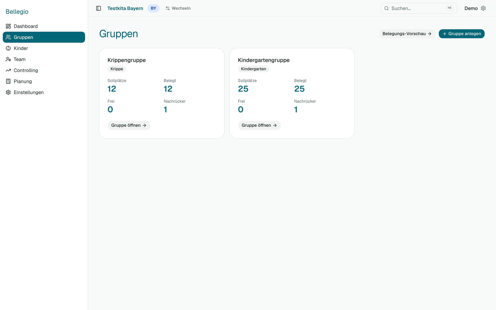

# 2 — Gruppen und Kinder

## Gruppen ansehen

Unter **Gruppen** siehst du alle Gruppen mit Plätzen und Belegung. Ein Klick öffnet eine Gruppe.

In der Gruppe siehst du die **Sitzplätze 1 bis Sollplätze**: belegte Plätze mit Namen (nach Alter sortiert), freie Plätze leer. Ein **Nachrücker**, der den Platz eines anderen Kindes übernimmt, steht auf dessen Platz. Außerdem siehst du, wann Plätze frei werden und wer nachrücken könnte.

## Eine Gruppe anlegen oder ändern

*Du brauchst das Recht „Kinder & Gruppen“ (ändern).*

1. **Gruppen → Gruppe anlegen**.
2. Name, Art (Krippe, Kindergarten, …) und **Sollplätze** eintragen.
3. Je nach Bundesland kommen Felder dazu: **Baden-Württemberg** Betriebsform, Öffnungszeit und Randzeit; **NRW** Gruppenform und Buchungszeit.
4. Speichern. Eine nicht mehr genutzte Gruppe kannst du in der Gruppe über **Bearbeiten** archivieren.

## Ein Kind aufnehmen

*Recht „Kinder & Gruppen“ (ändern).*

1. **Kinder → Kind anlegen**.
2. Vorname, Nachname, Geburtsdatum, Geschlecht.
3. **Gruppe** und **Status** wählen: *Aktiv* (ist da) oder *Nachrücker* (kommt noch).
4. **Eintritt** eintragen. Für Nachrücker ist er Pflicht.
5. **Austritt** eintragen — Pflicht für aktive Kinder und Nachrücker, damit Bellegio vorausplanen kann. Bellegio schlägt ein Datum vor (3. Geburtstag in der Krippe, 6. im Kindergarten, jeweils der nächste 1. September). Du kannst es ändern.
6. **Buchungszeit** wählen und „gültig ab“.
7. Weitere Angaben: Wohnort, I-Status (mit Zeitraum), Gewichtungsfaktoren (Bayern).
8. Speichern.

**Bayern:** Der Faktor „unter 3 / ab 3“ ergibt sich automatisch aus Geburtsdatum und Gruppe. Du setzt nur besondere Merkmale von Hand (nichtdeutschsprachige Eltern, Behinderung).

## Die Buchungszeit ändern

Die Buchungszeit eines Kindes ändert sich oft. So bleibt die Vergangenheit richtig:

1. Kind öffnen.
2. Neue **Buchungszeit** wählen und bei **gültig ab** das Datum, ab dem sie gilt (auch rückwirkend oder in der Zukunft).
3. Speichern. Bellegio merkt sich beide Zeiträume. Ein Blick auf einen früheren Stichtag zeigt weiter die damalige Buchungszeit.

## Nachrücker zuordnen

Du kannst festhalten, **wessen Platz** ein Nachrücker übernimmt:

- Am **Nachrücker** oder am **austretenden Kind** auf **Nachfolger zuordnen** gehen und das andere Kind wählen.
- Bellegio übernimmt das Datum und zeigt beide Kinder als Paar in Gruppe, Vorschau und Handlungsliste.
- Das ist optional — ohne Zuordnung bleibt der Platz „offen“.

## Von der Krippe in den Kindergarten

Wird ein Krippenkind bald drei, schlägt Bellegio einen Wechsel vor, **wenn** im Kindergarten ein Platz frei wird. Auf der Seite des Kindes steht **Wechsel planen**: Du legst den Termin fest, Bellegio ändert die Gruppe zum Termin automatisch. Ein geplanter Wechsel lässt sich zurücknehmen, solange er in der Zukunft liegt. Danach wird der Krippenplatz frei, und Bellegio schlägt Nachrücker vor.

## Notizen

Auf der Seite des Kindes: **Neue Notiz hinzufügen**. Jede Notiz bleibt mit Datum und Autor stehen; nichts wird überschrieben.

## Mehrere Kinder auf einmal: Excel-Import

*Recht „Kinder & Gruppen“ (ändern).*

1. **Kinder → Import**. Lade die **Vorlage** für dein Bundesland herunter und trage die Kinder ein.
2. Willst du bestehende Kinder **aktualisieren** statt nur neue anzulegen, schalte **„Mit bestehenden Einträgen abgleichen“** ein und wähle die Quelle (z. B. KigaRoo). Bellegio erkennt Kinder dann an der Nummer aus dieser Quelle (Spalte „Externe ID“).
3. **Datei auswählen**. Bellegio prüft zuerst nur — es wird noch nichts gespeichert.
4. Du siehst, welche Zeilen in Ordnung sind und welche Fehler haben (z. B. fehlendes Geschlecht, Nachrücker ohne Eintritt). Im Abgleich siehst du, was **neu** ist, was sich **ändert** (mit alt → neu) und was **unverändert** bleibt.
5. Klicke unten auf die Schaltfläche zum **Übernehmen** (z. B. „5 Kinder übernehmen“). Zeilen mit Fehlern bleiben draußen; du kannst sie korrigieren und erneut importieren.

Bellegio **löscht nie** automatisch Kinder, die in der Datei fehlen.

## Kinder suchen und exportieren

In der **Kinderliste** suchst du nach Name, sortierst nach Spalten und filterst. **Excel** exportiert die aktuelle Liste.

## Ein Kind verlässt die Einrichtung

Trage das **Austrittsdatum** ein. Das Kind bleibt als Verlauf erhalten. Archivierte Kinder erscheinen nicht mehr in den Listen. Wer das Recht „Träger-Admin“ hat, kann ausgetretene Kinder später **anonymisieren oder löschen** — siehe [Kapitel 6](06-einstellungen.md#datenschutz).

## Wenn etwas nicht klappt

- **„Aktive Kinder brauchen ein Austrittsdatum“:** Trage ein Austrittsdatum ein (letzter Tag eines Monats).
- **Das Kind erscheint in der Auswertung unter „Ohne Buchungszeit“:** Es fehlt die Buchungszeit oder ihr „gültig ab“ liegt nach dem Stichtag.
