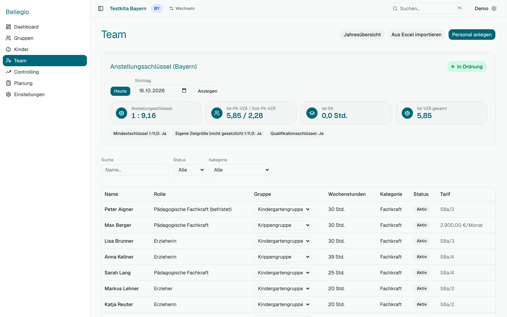

# 3 — Team

## Das Team ansehen

Unter **Team** siehst du alle Mitarbeitenden und darüber die **Personalplanung** deines Bundeslands: reicht das Personal für die Kinder? Die Darstellung unterscheidet sich je Land, weil die Gesetze verschieden rechnen (siehe [Glossar](07-glossar.md)).

- **Bayern:** Wie viele Kinder kommen auf eine Fachkraft? Erlaubt sind 11. Die App sagt: „9,2 Kinder je Fachkraft — erlaubt sind 11“.
- **Baden-Württemberg:** Wie viele Stellen (VZÄ) sind je Gruppe nötig, wie viele sind da?
- **NRW:** Wie viele Fachkraft- und Ergänzungskraftstunden sind nötig, wie viele sind da?

## Eine Person anlegen

*Recht „Personal“ (ändern).*

1. **Team → Personal anlegen**.
2. Vorname, Nachname, **Rolle** (z. B. Erzieherin).
3. **Kategorie (für den Anstellungsschlüssel):** Fachkraft, Ergänzungskraft usw. — das bestimmt, wie die Stunden zählen.
4. **Wochenstunden**, **Gruppe** (optional), **Status**, **Eintritt** und **Austritt** (Vertragsende), falls bekannt.
5. Speichern.

## Stunden je Monat und Ausfälle

- **Jahresübersicht:** Unter **Team → Jahresübersicht** siehst du jede Person mit ihren Stunden für jeden Monat. Klicke in ein Feld, um die Stunden für diesen Monat zu ändern (z. B. Reduzierung ab Mai). Die Änderung wirkt sofort in allen Ampeln und im Controlling.
- **Ausfallzeiten:** Auf der Seite der Person kannst du Krankheit, Schwangerschaft, Mutterschutz, Sonderurlaub und Sonstiges eintragen (Von–Bis). Deckt ein Ausfall einen ganzen Monat ab, zählt der Monat mit 0 Stunden. Läuft aktuell ein Langzeitausfall, erscheint ein Hinweis im Dashboard.

## Vergütung

*Recht „Einzelgehälter“.*

Auf der Seite der Person gibt es den Abschnitt **Vergütung**:

- **Entgeltgruppe und Stufe** nach TVöD (Sozial- und Erziehungsdienst), z. B. S 8a, Stufe 3 — Bellegio rechnet das Gehalt aus der Tarifliste, inklusive der SuE-Zulage, und bei Teilzeit anteilig.
- **Oder ein manuelles Monatsgehalt** (Vollzeit) — das ersetzt die Tariftabelle, etwa bei kirchlichen oder privaten Trägern.

Ohne eine der beiden Angaben zählt die Person als **„nicht erfasst“** und wird in den Personalkosten nicht mitgerechnet. Bellegio weist das aus.

Wer nur das Recht „Finanzübersicht“ hat, sieht Summen, aber keine Einzelgehälter.

## Personal importieren

Wie bei Kindern: **Team → Import**, Vorlage herunterladen, Datei prüfen lassen, übernehmen. Quelle kann z. B. rexx sein. Gehälter kommen **nicht** mit — die pflegst du direkt bei der Person.

## Eine Person verlässt die Einrichtung

Trage das **Austrittsdatum** ein. Die Person wird ab diesem Monat in den Auswertungen nicht mehr gezählt. Der Träger-Admin kann ausgeschiedene Personen später anonymisieren oder löschen ([Kapitel 6](06-einstellungen.md#datenschutz)).

## Wenn etwas nicht klappt

- **Die Ampel zeigt „zu wenig Personal“, obwohl alle da sind:** Prüfe die Kategorie (Fachkraft/Ergänzungskraft), die Wochenstunden und ob jemand einen Austritt eingetragen hat.
- **Die Spalte „Tarif“ fehlt:** Du hast nicht das Recht „Einzelgehälter“.
