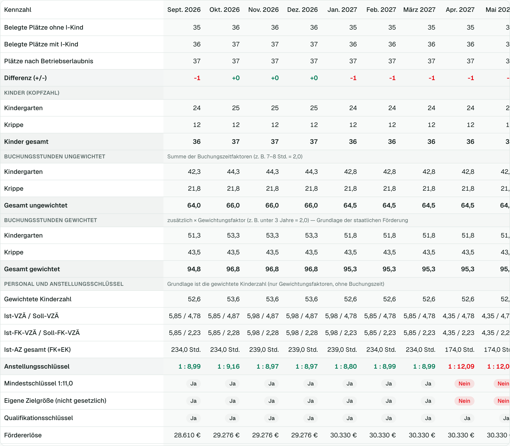
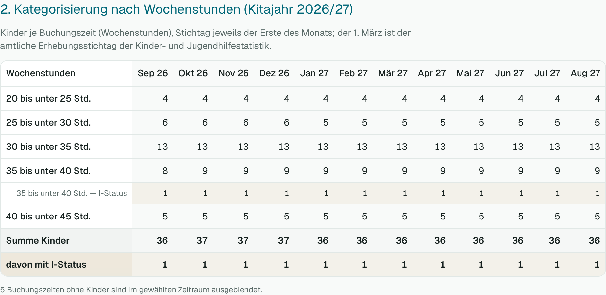
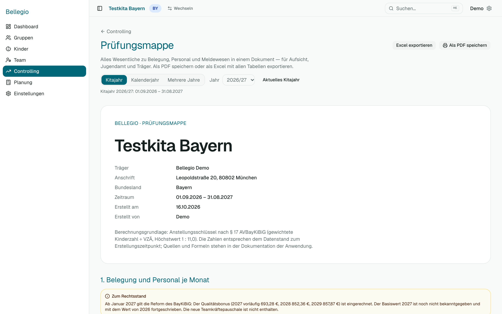

# 4 — Controlling

Das Controlling zeigt dir die Zahlen **über die Zeit** — Monat für Monat. Es ist für dich, wenn du Entwicklungen prüfen oder etwas nachweisen musst.

## Zeitraum wählen

Oben wählst du den Zeitraum: ein **Kitajahr** (Bayern und Baden-Württemberg ab 1. September, NRW ab 1. August), ein **Kalenderjahr** oder **mehrere Jahre**.

## Übersicht oder alle Kennzahlen

- **Übersicht** zeigt das Wichtige: Kinder, Plätze, Personal-Ampel, Schlüssel und — mit Recht „Finanzübersicht“ — Einnahmen, Personalkosten und Ergebnis.
- **Alle Kennzahlen** zeigt jede Zeile: gewichtete Kinderzahl, Anstellungsschlüssel, Krippe und Kindergarten getrennt, Förderung aufgeschlüsselt.

## Die Zeilen lesen

| Zeile | Bedeutung |
| --- | --- |
| Kinder / Plätze | Wie viele Kinder sind da, wie viele Plätze gibt es? |
| Personal | Ampel: In Ordnung, Knapp, Zu wenig Personal, Mehr Personal als nötig |
| Anstellungsschlüssel (Bayern) | Kinder je Fachkraft; 1 : 11 ist das Maximum |
| Fördererlöse | Die Förderung nach dem Gesetz deines Bundeslands; in Bayern getrennt in staatlich und kommunal |
| Elternbeiträge | Aus deiner Preisliste (Einstellungen → Finanzen), nur wenn eine hinterlegt ist |
| Personalkosten | Gehälter nach Tarif oder manuell, plus Lohnnebenkosten und anteilige Jahressonderzahlung |
| Sonstige Kosten | Was du in den Einstellungen für Miete, Verpflegung u. Ä. eingetragen hast |
| **Ergebnis** | Einnahmen minus Kosten — eine **Planungsgröße**, kein Jahresabschluss |

Wo das Landesrecht sich ändert (z. B. Bayern ab 2027), steht über der Tabelle ein **Hinweis zum Rechtsstand**. Monate danach beruhen auf vorläufigen Werten.

## Kinder nach Buchungszeit

Unter der Tabelle siehst du, wie viele Kinder in welcher Buchungszeit-Kategorie sind, Monat für Monat, auch die Kinder mit **I-Status**. Das brauchst du für Meldungen an die Behörden. Kinder ohne zuordenbare Buchungszeit werden gesondert ausgewiesen.

## Prüfungsmappe

Die **Prüfungsmappe** fasst alles für einen Nachweis zusammen: Belegung, Personal, Ampeln und Kategorisierung.

1. **Controlling → Prüfungsmappe**.
2. Zeitraum wählen.
3. **Als PDF speichern** (öffnet den Druckdialog deines Browsers; dort „Als PDF speichern“) oder **Excel** herunterladen.

## Exportieren

Über die Schaltflächen oben auf der Seite lädst du die Tabelle als **Excel-Datei** herunter. Sie enthält dieselben Zeilen wie die Ansicht.

## Wenn etwas nicht klappt

- **Das Ergebnis ist im Minus:** Siehe [Häufige Fragen](08-haeufige-fragen.md#warum-ist-mein-ergebnis-im-minus).
- **Fördererlöse fehlen:** In Baden-Württemberg gibt es keine Landesformel — trage den Betrag unter Einstellungen → Finanzen ein.
- **Du siehst keine Geldzeilen:** Dir fehlt das Recht „Finanzübersicht“.
