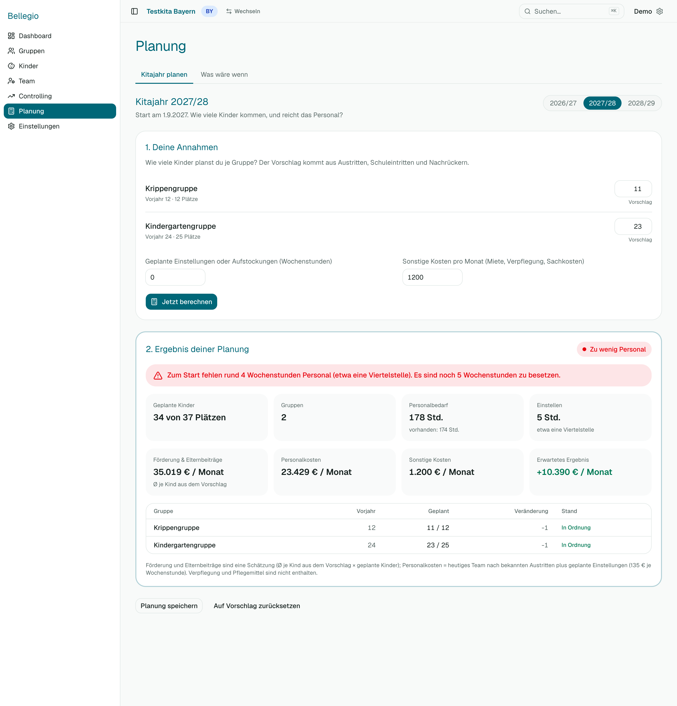

# 5 — Planung

Unter **Planung** rechnest du ein Kitajahr durch, bevor es beginnt: Wie viele Kinder, wie viel Personal, wie sieht das Ergebnis aus? Es gibt zwei Reiter.

## Kitajahr planen

Der Hauptfall. Bellegio macht einen **Vorschlag** aus dem, was es schon weiß: Austritte (z. B. Schulkinder), feste Nachfolger, geplante Wechsel.

1. **Planung → Kitajahr planen**. Wähle das Kitajahr.
2. In der Tabelle siehst du je Gruppe das **Vorjahr**, die **geplanten** Kinder und die Veränderung. Ändere die geplanten Kinder, wo du es besser weißt.
3. Trage **Geplante Einstellungen oder Aufstockungen (Wochenstunden)** ein.
4. Mit Recht „Finanzübersicht“ trägst du außerdem **Sonstige Kosten pro Monat** ein (Miete, Verpflegung, Sachkosten; vorbelegt aus den Einstellungen).
5. Klicke **Jetzt berechnen**.

Unter „Ergebnis deiner Planung“ siehst du:

- **Geplante Kinder** gegen die Plätze und die **Gruppen**,
- **Personalbedarf** gegen das vorhandene Personal in Stunden und die Zeile **Einstellen**: wie viele Wochenstunden dir fehlen oder übrig sind,
- mit Finanzrecht: **Förderung & Elternbeiträge**, **Personalkosten**, **Sonstige Kosten** und das **Erwartete Ergebnis** je Monat.

**Wichtig:** Ändere ich die Annahmen, bleibt das Ergebnis stehen, bis ich wieder **Jetzt berechnen** klicke. Darauf weist eine Zeile hin („Annahmen geändert … Bitte neu berechnen“). So schwankt nichts, während du tippst.

Mit **Planung speichern** hältst du den Stand fest, **Auf Vorschlag zurücksetzen** verwirft deine Änderungen. Speichern darfst du mit dem Recht „Szenario-Rechner (ändern)“.

Förderung und Elternbeiträge sind hier eine **Schätzung** (Durchschnitt je Kind × geplante Kinder).

## Was wäre wenn?

Hier spielst du mit dem Heute: Du veränderst Gruppen, Kinder oder Personal und siehst, wie sich Personalbedarf und Ergebnis ändern. Jedes Bundesland hat seinen eigenen Rechner (Bayern: Kinder und Faktoren; Baden-Württemberg: Betriebsform und Öffnungszeit; NRW: Gruppenform und Buchungszeit).

1. **Planung → Was wäre wenn?**
2. Verändere die Annahmen (z. B. eine Gruppe mehr, eine Kraft weniger).
3. Mit Finanzrecht trägst du je Personal-Zeile das **Gehalt (Vollzeit)** ein — bei echten Mitarbeitenden ist es vorbelegt.
4. **Jetzt berechnen**.

Die Förderung bleibt dabei auf dem heutigen Wert; nur Personal und Personalkosten reagieren auf deine Annahmen.

## Wenn etwas nicht klappt

- **Nach dem Klick passiert nichts:** Prüfe, ob in jeder Zeile eine Zahl steht.
- **Keine Geldzeilen:** Dir fehlt das Recht „Finanzübersicht“.
- **Das Ergebnis weicht von Controlling ab:** Die Planung nutzt Durchschnitte und deine Annahmen; Controlling rechnet jeden Monat aus den echten Daten.
