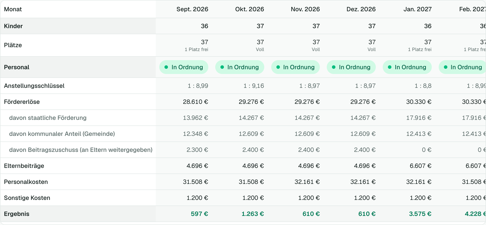

# 6 — Einstellungen

Alles Seltene steht unter **Einstellungen**, als Reiter. Du siehst nur die Reiter, die du nutzen darfst.

## Einrichtung

Grunddaten, Kontakt, Öffnungszeiten und die Vollzeit-Referenz (Wochenstunden einer Vollzeitkraft, Standard 39). Ändern darf das die Träger-Administration. Das **Bundesland** ist nach dem Anlegen fest, weil davon die Rechenregeln abhängen.

## Finanzen

*Recht „Finanzübersicht“.* Hier stellst du ein, womit Bellegio das Ergebnis rechnet.

| Einstellung | Wofür |
| --- | --- |
| **Manueller Förderbetrag** | Ersetzt die Formel. In **Baden-Württemberg** nötig (keine Landesformel), sonst nur, wenn dein Bescheid vom berechneten Wert abweicht |
| **Personalprogramme (Förderung)** | Nur eintragen, wenn die Fördervoraussetzungen erfüllt sind — sonst wird nichts angesetzt |
| **Teamkräftepauschale (Bayern ab 2027)** | Schalter. Nur anhaken, wenn mindestens eine Teamkraft beschäftigt ist (ab 100 Plätzen mit mindestens 35 Wochenstunden) |
| **Sonstige Kosten** | Miete, Verpflegung, Sachkosten pro Monat — mindern das Ergebnis |
| **Lohnnebenkosten** und **Jahressonderzahlung** | Schätzwerte (Standard 28 % und 85 %); passe sie an deinen Träger an |
| **Elternbeiträge (eure Preisliste)** | Monatsbeitrag je Buchungszeit. Schalter für „Krippe und Kindergarten haben unterschiedliche Preise“, „Kinder von außerhalb zahlen einen anderen Preis“, Geschwisterermäßigung und Elternbeitragszuschuss (Bayern bis 2026) |

**Preisliste eintragen:**

1. Trage in der Tabelle je Buchungszeit den Monatsbeitrag ein. Schalte vorher ein, ob nach Krippe/Kindergarten und Wohnsitz unterschieden wird.
2. Bei Wohnsitz-Unterscheidung die **Standort-Gemeinde** eintragen; Kinder mit anderem Wohnort zahlen die Spalte „von außerhalb“.
3. **Preisliste speichern**, mit „Gültig ab“ für den Beginn.

Verpflegung, Pflegemittel und Zusatzstunden rechnet Bellegio nicht ein; sie sind meist Durchlaufposten.

## Nutzer und Rechte

*Träger-Administration, Rechteverwalter und lokale Administration (für ihre Einrichtungen).*

**Einen Nutzer anlegen:**

1. **Einstellungen → Nutzer & Rechte → Nutzer anlegen**.
2. Name und E-Mail eintragen.
3. Entweder per **E-Mail einladen** (die Person legt ihr Passwort selbst fest) oder ein **Passwort direkt vergeben**.
4. Einrichtungen auswählen. Bei vielen Einrichtungen helfen **Cluster auswählen** und **Alle auswählen**.
5. Rechte je Bereich festlegen.

**Die Rechte** stellst du mit Ein/Aus-Schaltern ein — je Einrichtung und Bereich:

| Bereich | Bedeutet |
| --- | --- |
| Kinder & Gruppen | Kinder, Gruppen, Nachrücker, Import |
| Personal | Mitarbeitende, Stunden, Ausfälle |
| Controlling | Zahlen und Prüfungsmappe |
| Szenario-Rechner | Planung |
| Finanzübersicht | Summen: Förderung, Kosten, Ergebnis, Preisliste |
| Einzelgehälter | Entgeltgruppe, Stufe, Gehalt je Person |

Je Bereich gibt es **Ansehen** und **Ändern**. „Ändern“ setzt „Ansehen“ voraus. Die **Einrichtungsleitung** hat standardmäßig alles außer Finanzübersicht und Einzelgehälter.

- **Für ganzes Cluster setzen** überträgt eine Einstellung auf alle Einrichtungen eines Clusters.
- **Sperren** hält einen Nutzer aus, **Löschen** entfernt ihn. Träger-Administratoren kannst du nicht sperren oder löschen.
- Ein **Marketing-Recht** (ansehen/bearbeiten) vergibt nur die Träger-Administration.

**Du kannst nicht mehr Rechte vergeben, als du selbst hast.**

## Einrichtungen

*Träger-Administration.* Hier legst du neue Einrichtungen an (**Neue Einrichtung**), pflegst **Kostenstelle** und **Cluster** (freie Felder zum Gruppieren und für die Buchhaltung) und **archivierst** nicht mehr genutzte Einrichtungen. Archivierte Einrichtungen verschwinden aus der Auswahl, ihre Daten bleiben erhalten.

## Datenschutz

*Träger-Administration.*

- **Löschfristen:** Wie lange ausgetretene Kinder und ausgeschiedenes Personal aufbewahrt werden, bevor Bellegio erinnert. Gelöscht wird nie automatisch.
- **Anonymisieren oder Löschen:** Auf der Seite eines **ausgetretenen** Kindes (oder ausgeschiedenen Mitarbeitenden) gibt es die Datenschutz-Aktionen. Anonymisieren entfernt Name und Notizen, behält aber die Zahlen für die Statistik; Löschen entfernt den Datensatz ganz. Beides ist endgültig und wird protokolliert (ohne persönliche Inhalte).
- **Auskunft nach Art. 15 DSGVO:** Auf der Seite des Kindes oder der Person öffnest du die **Auskunft** — alle gespeicherten Daten und die Änderungshistorie zum Ausdrucken.

## Rechtsgrundlagen

Hier steht, **wie Bellegio rechnet und woher die Werte stammen**: Gesetze, Beträge, Quellen und der Prüfstand — je Bundesland.

## Mein Profil

Eigenen Namen ändern, Passwort ändern und **Zwei-Faktor-Anmeldung** einrichten (Authenticator-App).
